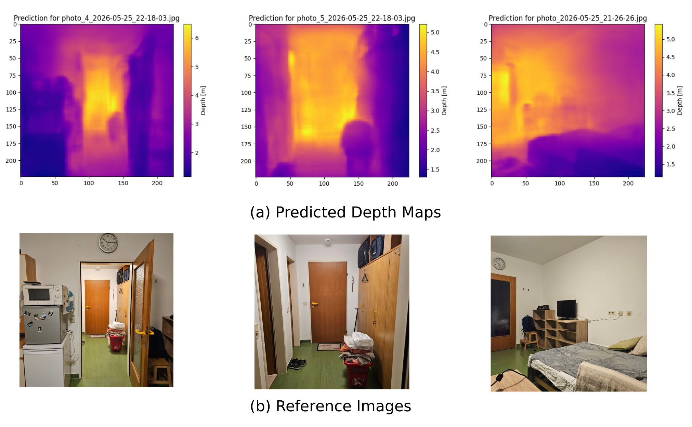

# FastDepth Monocular Depth Estimation
This repo provides an implementation of the monocular depth estimation architecture presented in the paper "FastDepth: Fast Monocular Depth Estimation on Embedded Systems" by Diana Wofk et al.
The architecture was implemented in PyTorch. Training was performed on the NYU DepthV2 dataset. Trained model file, as well as a small compiled web demo is also provided.

## Implementation Details
### Data Preprocessing
For the RGB input images, the Eigen crop is applied to account for the known dataset artefacts. Additionally, color jitter and random horizontal flips are done.
Nearest Neighbour Interpolation is used for the ground truth rescaling to preserve the sharp depth drops and avoid blurred transitions.
### Architecture
Architecture was done according to the paper, with the best performing encoder and decoder chosen for implementation.
Pretrained MobileNetV2 was used as an encoder, with weight freezing to prevent weight degradation on initial epochs.
NNConv5 was used as a decoder, with Nearest Neighbour Interpolation for upscaling.
### Training
Training was done using the L1 loss and the SGD optimiser. RMSE and $$\delta 1$$ were used as the evaluation parameters.
Additional functionality to stop, freeze and resume training from a checkpoint was added. TensorBoard logging is supported.

## Results
Model converged on the 13th epoch with RMSE=0.6276 and $$\delta 1$$=0.7834. This mirrors the results of the paper, with $$\delta 1$$ being slightly higher and RMSE about 4 cm lower.

Intermediate model file is provided, with model frozen at epoch 13 batch 1420 (batch size 8).
Also a simple web demo application is provided, which allows you to run the compiled onnx web runtime locally in the browser. To run it, host the local HTTP server with html and onnx files.
